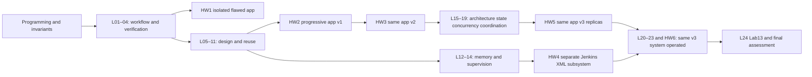

# Concept and prerequisite map

Reconstructed study map derived from every available Fall deck. The official Fall schedule determines the order; dates and breaks do not become learner deadlines. The deck filename defines the stable lecture ID even where slide title/footer numbering is inconsistent.

Each lecture row requires an unassisted recall answer in the learner’s own notes. These replace unavailable in-class participation activities for self-study; they are not official quizzes.

## LEC-01: Course Introduction and Modern Software Engineering

- Objective: Distinguish producing code from owning verification, evolution, and operation.
- Source: [01-introduction.pdf](https://github.com/CMU-17-214/f2026/blob/3f5235eb6a9c652823cb21167846f978eea66c7e/slides/01-introduction.pdf); PDF pages 11–15; 18–28; 31–45.
- Prerequisites: Two programming courses or equivalent; basic algorithms, data structures, invariants.
- Concepts/explanations/examples: Tetris demo versus shippable system; reach, verifiability, and reversibility determine delegation; six assignment themes and accountable ownership.
- Independent explanation check: For a generated feature, name a cheap verification step and a failure whose reach makes human review necessary.
- Gap action: The live demo and image-only slides cannot substitute for explanation. Use the written course goals and compare a demo claim with a maintained-system obligation.
- Spring comparison: [Intro, IDEs, Build Systems, CI, Libraries](https://docs.google.com/presentation/d/1U0qfmIeOkD6BGVgyaty5HmxcbqSBTjT9FT7t8sAxECg/edit?usp=sharing) — targeted support, not mandatory duplicate coursework.

## LEC-02: Agentic Development and Design for Verification

- Objective: Design, decompose, generate, verify, and commit in bounded tasks; externalize context and define takeover conditions.
- Source: [02-agentic-development.pdf](https://github.com/CMU-17-214/f2026/blob/3f5235eb6a9c652823cb21167846f978eea66c7e/slides/02-agentic-development.pdf); PDF pages 11–20; 23–37; 40–50.
- Prerequisites: L01; git diff/branch/commit concepts.
- Concepts/explanations/examples: Tetris state/rules/input/rendering/scoring decomposition; finite context and rot; instructions versus enforced hooks; bad-generation recovery and disk-backed fresh-session loops.
- Independent explanation check: Write one task with inputs, scope, a gate, a rollback checkpoint, and a takeover condition; explain why an instruction file alone cannot enforce it.
- Gap action: CLI commands and permission semantics are tool/version specific. Verify the chosen tool and transcript export at Lab 1; do not install multiple agents or copy an unverified hook.
- Spring comparison: No matching Spring replacement required; use Fall.

## LEC-03: Testing and Testability

- Objective: Evaluate controllability and observability; isolate domain rules and audit meaningful assertions.
- Source: [03-testing-and-testability.pdf](https://github.com/CMU-17-214/f2026/blob/3f5235eb6a9c652823cb21167846f978eea66c7e/slides/03-testing-and-testability.pdf); PDF pages 4–22; 24–38; 40–54.
- Prerequisites: L02; Java interfaces/visibility, exceptions, basic JUnit assertions.
- Concepts/explanations/examples: BookingService hides a real clock and repository and returns void; injection makes time controllable, a result observable. Ports/adapters, test doubles including saboteurs, SOLID, discovery counts, oracle problems, and architecture tests.
- Independent explanation check: Explain how a passing booking test can lack either control or observation, and identify what its oracle should be.
- Gap action: Framework syntax and fake/stub/mock distinctions may be unfamiliar. Spring Testability and the Test Doubles handout supply targeted prerequisite explanations; use only if the learner cannot explain the Clock example.
- Spring comparison: [Testability](https://docs.google.com/presentation/d/1Mf46KEj-XPN08qRG2xjKrB2wzZrOwlsn4YjkWBBQdnU/edit?usp=sharing) — targeted support, not mandatory duplicate coursework.

## LEC-04: Test Design and Coverage

- Objective: Derive equivalence classes, boundaries, and properties from a specification; distinguish coverage from fault detection.
- Source: [04-test-design-and-coverage.pdf](https://github.com/CMU-17-214/f2026/blob/3f5235eb6a9c652823cb21167846f978eea66c7e/slides/04-test-design-and-coverage.pdf); PDF pages 10–18; 20–37; 39–57.
- Prerequisites: L03; Boolean conditions, interval arithmetic, deterministic test assertions.
- Concepts/explanations/examples: Bank-account pre/postconditions and invariants; shipping-weight partitions; half-open intervals; jqwik-style generated sequences and shrinking; integration joints; branch/path coverage, Goodhart, mutation testing and adequacy rationale.
- Independent explanation check: Give a boundary bug a 100% branch-covered suite could miss, and one invariant that generated sequences would test.
- Gap action: jqwik and fast-check use different APIs. Read their official property/generator/shrinking documentation before Lab 2 and HW1 respectively; the conceptual PBT explanation is already in Fall.
- Spring comparison: [Test Case Design](https://docs.google.com/presentation/d/16yBPiNcjhJB9iYQA5b09ViOSllyOWBZBazVu2rnMlIQ/edit?usp=sharing) — targeted support, not mandatory duplicate coursework.

## LEC-05: What Is a Software System's Design?

- Objective: Model data, operations, structure, responsibilities, and invariants; compare decompositions using quality attributes.
- Source: [05-what-is-design.pdf](https://github.com/CMU-17-214/f2026/blob/3f5235eb6a9c652823cb21167846f978eea66c7e/slides/05-what-is-design.pdf); PDF pages 4–14; 22–46; 49–65.
- Prerequisites: L04; entities/values, references, basic HTTP request/response concepts.
- Concepts/explanations/examples: Next-free-booking ambiguity demonstrates validation-first design. Room/User/Booking entity/value model; half-open intervals versus slots; reference ownership, error precedence, tolerant readers, representational gap and availability caches.
- Independent explanation check: Compare interval and fixed-slot models; name an invariant every operation inherits and one change made expensive by each design.
- Gap action: The public brief omits core-api-v1.md, so slide examples cannot recover its full interface. Release a clearly reconstructed contract at HW2 preparation. Spring OO/UML supports diagram reading if needed.
- Spring comparison: [OO Analysis and UML](https://docs.google.com/presentation/d/10bsxafe_IYbS811YUQFcbFh1XQsjhCxLODgiY_xosfk/edit?usp=sharing) — targeted support, not mandatory duplicate coursework.

## LEC-06: Communicating and Recording Designs

- Objective: Record decisions with real alternatives and costs; read sequence/dataflow diagrams and maintain durable agent context.
- Source: [06-communicating-designs.pdf](https://github.com/CMU-17-214/f2026/blob/3f5235eb6a9c652823cb21167846f978eea66c7e/slides/06-communicating-designs.pdf); PDF pages 12–27; 29–49; 54–60.
- Prerequisites: L05; requests and object calls; distinguish what from why.
- Concepts/explanations/examples: ADR overlap-check and SQLite critiques; accepted records are superseded. A cancellation trace violates ordering and waitlist obligations. Architecture sketches, dataflow trust boundaries, instruction files, skills and pattern vocabulary.
- Independent explanation check: Identify a fake alternative in an ADR and explain how a sequence diagram can contradict an invariant.
- Gap action: Fall already provides ADR form, examples, and failure modes. No mandatory external ADR course is needed. Tool-specific instruction/skill behavior is checked at its JIT trigger.
- Spring comparison: [OO Analysis and UML](https://docs.google.com/presentation/d/10bsxafe_IYbS811YUQFcbFh1XQsjhCxLODgiY_xosfk/edit?usp=sharing) — targeted support, not mandatory duplicate coursework.

## LEC-07: Design for Change

- Objective: Evaluate coupling/cohesion and assign responsibilities using information hiding and GRASP heuristics.
- Source: [07-design-for-change.pdf](https://github.com/CMU-17-214/f2026/blob/3f5235eb6a9c652823cb21167846f978eea66c7e/slides/07-design-for-change.pdf); PDF pages 13–34; 37–45; 48–59.
- Prerequisites: L05–L06; interfaces, object references and dependency direction.
- Concepts/explanations/examples: Booking waitlist coordinator versus Room doing everything; import, hidden/global, control and temporal coupling; Information Expert, Creator, Controller, Protected Variations, Pure Fabrication; stable dependency direction and safe delegation.
- Independent explanation check: Assign waitlist promotion and notification responsibilities, then predict which modules an SMS requirement changes.
- Gap action: Spring Responsibility Assignment can deepen GRASP if the learner cannot price the waitlist tradeoff; do not require implementing Spring Santorini.
- Spring comparison: [Responsibility Assignment](https://docs.google.com/presentation/d/1TZ4_QRDg3VMI__uvTyfdRXfZPWWeiAXK9E_f-CB3WSg/edit?usp=sharing) — targeted support, not mandatory duplicate coursework.

## LEC-08: Modularity and Anti-Patterns

- Objective: Diagnose consequential smells and distinguish them from false positives in generated code.
- Source: [08-modularity-and-anti-patterns.pdf](https://github.com/CMU-17-214/f2026/blob/3f5235eb6a9c652823cb21167846f978eea66c7e/slides/08-modularity-and-anti-patterns.pdf); PDF pages 12–35; 40–58.
- Prerequisites: L07; cohesion/coupling and contextual change costs.
- Concepts/explanations/examples: God class, feature envy, intimacy, shotgun surgery, divergence, cycles, hidden dependencies, primitive obsession, flags, refused bequest; agent duplication, over-abstraction, convention drift, phantom complexity and inflated comments.
- Independent explanation check: Tie one smell to a file, violated principle, and likely change cost; give one justified false positive.
- Gap action: The Spring refactoring lab appendix is a useful smell catalog, not a replacement exercise. Midterm 1 explicitly excludes this lecture despite occurring afterward.
- Spring comparison: [Refactoring and Anti-patterns](https://docs.google.com/presentation/d/1Bsh5GDdpP364Q4pQ1qfNkCiOjGqr2b0AOO1b61W-gU4/edit?usp=sharing) — targeted support, not mandatory duplicate coursework.

## LEC-09: Refactoring and Design Improvement

- Objective: Pin externally observable behavior before a scoped refactor and choose refactoring versus regeneration on evidence.
- Source: [09-refactoring.pdf](https://raw.githubusercontent.com/CMU-17-214/f2026/3f5235eb6a9c652823cb21167846f978eea66c7e/slides/09-refactoring.pdf); PDF pages 7–17; 19–38; 42–50.
- Prerequisites: L08; test oracle distinction, git history and public behavior.
- Concepts/explanations/examples: Two hats separate restructuring from behavior changes; characterize zero-length booking even if buggy; extraction rhythm; count read moved after insert changes fee tiers; coverage, code age, spec quality and reach decide two roads.
- Independent explanation check: Explain why a preserved bug belongs in a characterization test and identify a changed observation in a purported cleanup.
- Gap action: Existing suite green is only a starting point. Spring refactoring offers extra examples; Lab 7 and Jenkins supply the required practice without another mandatory codebase.
- Spring comparison: [Refactoring and Anti-patterns](https://docs.google.com/presentation/d/1Bsh5GDdpP364Q4pQ1qfNkCiOjGqr2b0AOO1b61W-gU4/edit?usp=sharing) — targeted support, not mandatory duplicate coursework.

## LEC-10: Design Patterns and Tradeoffs

- Objective: Match Strategy, Observer and Factory to actual variation; price indirection and identify pattern misuse.
- Source: [10-design-patterns.pdf](https://github.com/CMU-17-214/f2026/blob/3f5235eb6a9c652823cb21167846f978eea66c7e/slides/10-design-patterns.pdf); PDF pages 7–29; 31–47.
- Prerequisites: L07–L09; interfaces, composition, inheritance and polymorphism.
- Concepts/explanations/examples: Pricing policy injected by composition; cancellation subscriptions; centralized notifier creation; Open/Closed along one axis; testability injection points, quality attributes and pattern soup.
- Independent explanation check: For one pattern, state the problem, roles, benefit and concrete cost; describe the requirement that would justify an otherwise excessive layer.
- Gap action: If composition versus inheritance is unfamiliar, read Spring Inheritance and Delegation before this deck. Fall teaches the patterns; no extra pattern implementation is required.
- Spring comparison: [Inheritance and Delegation](https://docs.google.com/presentation/d/1S6J5aaNo8UydPikpECoZbJUJeriBo89RoxYv3GrW_eQ/edit?usp=sharing) — targeted support, not mandatory duplicate coursework.

## LEC-11: APIs, Libraries, and Frameworks

- Objective: Design hard-to-misuse APIs and contract checks; distinguish library calls from framework inversion of control.
- Source: [11-apis-libraries-frameworks.pdf](https://raw.githubusercontent.com/CMU-17-214/f2026/3f5235eb6a9c652823cb21167846f978eea66c7e/slides/11-apis-libraries-frameworks.pdf); PDF pages 6–25; 28–40; 43–56.
- Prerequisites: L10 and Lab 6 introduction; compiler types and HTTP validation.
- Concepts/explanations/examples: Typed UserId/RoomId/TimeRange; errors and LSP/ISP; Hyrum and deprecation; contract tests with real versus fake collaborators; Template Method, Adapter, reuse versus generated RFC recurrence support.
- Independent explanation check: Show a compiler-enforced misuse constraint and a network boundary that still needs runtime validation; propose a compatibility path.
- Gap action: Lab 6 precedes this lecture and has its own additive/breaking/deprecation primer. Read that primer before Lab 6; Spring API Design is optional explanation, not a prerequisite ordering change.
- Spring comparison: [API Design](https://docs.google.com/presentation/d/1zp7MZu08Cx9dEm6T-PwnXqgy87UC8-yclEc-942huIM/edit?usp=sharing) — targeted support, not mandatory duplicate coursework.

## LEC-12: Evolution, Drift, and Decision Archaeology

- Objective: Recover a bounded codebase model and distinguish evidenced design history from inferred rationale.
- Source: [12-evolution-drift-memory.pdf](https://raw.githubusercontent.com/CMU-17-214/f2026/3f5235eb6a9c652823cb21167846f978eea66c7e/slides/12-evolution-drift-memory.pdf); PDF pages 6–26; 29–47.
- Prerequisites: L11; git log/blame and bounded request tracing.
- Concepts/explanations/examples: Lehman and incremental drift; architecture import checks; examine/probe/modify; Jenkins modules and queue trace; git log -S and blame recover records, while unknown rationale stays unknown.
- Independent explanation check: Trace one claim to code, a dated record and a probe; label which part of the rationale remains unknown.
- Gap action: HW4 requires full history and historical record revisions. A shallow Jenkins checkout is inadequate; acquire the exact tag and history only at HW4 preparation. Fall already teaches engineering memory.
- Spring comparison: No matching Spring replacement required; use Fall.

## LEC-13: Agent Architectures

- Objective: Explain model, assembled context, tools and harness; bound reach and evaluate a setup across repeated tasks.
- Source: [13-agent-architectures.pdf](https://github.com/CMU-17-214/f2026/blob/3f5235eb6a9c652823cb21167846f978eea66c7e/slides/13-agent-architectures.pdf); PDF pages 8–19; 21–36; 38–51.
- Prerequisites: L02, L06, L12; APIs and least privilege.
- Concepts/explanations/examples: Bug-triage agent illustrates retrieval misses, tool APIs, permissions, MCP dependencies, lazy skills, structured output shape versus truth, coordination handoff loss and SWE-bench-style repeated evals.
- Independent explanation check: Give a triage agent its narrowest action space, distinguish schema validity from a correct severity judgment, and name an eval blind spot.
- Gap action: Fall covers the concepts. Current MCP participants/layers documentation supplements the protocol boundary only. Tool counts and permission UI in slides are snapshot-specific, not promises about installed tools.
- Spring comparison: No matching Spring replacement required; use Fall.

## LEC-14: Agent Supervision and Safety

- Objective: Define slices, gates, guardrails, fresh-context refutation, takeover conditions and independent evidence.
- Source: [14-agent-supervision.pdf](https://github.com/CMU-17-214/f2026/blob/3f5235eb6a9c652823cb21167846f978eea66c7e/slides/14-agent-supervision.pdf); PDF pages 8–18; 20–40; 42–51.
- Prerequisites: L13; tests, diff review and process records.
- Concepts/explanations/examples: Exception-to-result migration template gate then batches; overnight loops compound mistakes; refuter findings need reproduction; deny rules/hooks/sandboxes and bypasses; prompt injection, reward hacking, budget/turn caps and externally recorded actions.
- Independent explanation check: Write a slice gate that could still miss a bug; explain how to settle a refuter finding and why filesystem enforcement differs from a prompt.
- Gap action: Provider-specific permission behavior can drift. Lab 8 must demonstrate a real block in the selected tool and manual approval mode where relevant. Reading a configuration is insufficient; no blanket autonomous run is needed.
- Spring comparison: No matching Spring replacement required; use Fall.

## LEC-15: Software Architecture and Subsystem Design

- Objective: Choose subsystem boundaries and data ownership; verify dependency rules and justify service boundaries.
- Source: [15-software-architecture.pdf](https://github.com/CMU-17-214/f2026/blob/3f5235eb6a9c652823cb21167846f978eea66c7e/slides/15-software-architecture.pdf); PDF pages 6–21; 23–43; 44–48.
- Prerequisites: L07, L11, L14; ownership and dependency direction.
- Concepts/explanations/examples: Layers, ports/adapters, pipes/filters and event styles; ArchUnit baselines; code versus stale diagrams; Conway, one data writer, modular monolith versus services, Segment consolidation and Facade costs.
- Independent explanation check: Draw one data owner and its public boundary, justify keeping or extracting a service, and name an enforceable architecture rule.
- Gap action: No conceptual replacement needed. Lab 9 uses import/call evidence rather than trusting ARCHITECTURE.md, and preserves production code/tests.
- Spring comparison: [Libraries and Frameworks](https://docs.google.com/presentation/d/1JgJLly89jxganL_vthxo0R9HUcbTyea3yPRKjIShbRo/edit?usp=sharing) — targeted support, not mandatory duplicate coursework.

## LEC-16: Data Models at Scale (deck: State at Scale)

- Objective: Locate state, evaluate replica correctness and scaling, and reason about persistence and schema evolution.
- Source: [16-data-models-at-scale.pdf](https://github.com/CMU-17-214/f2026/blob/3f5235eb6a9c652823cb21167846f978eea66c7e/slides/16-data-models-at-scale.pdf); PDF pages 5–15; 17–29; 31–52.
- Prerequisites: L15; processes versus memory, basic persistence and percentiles.
- Concepts/explanations/examples: Process-local sessions fail across copies; Compose DNS and X-Upstream checks; k6 correctness/throughput/p95; locked versus database-constrained curve; N+1, keys, cache freshness, lost updates, read models, sharding, expand/migrate/contract and restore checks.
- Independent explanation check: Explain a false scaling result caused by one active replica; choose a consistency requirement and an online schema transition.
- Gap action: Compose/k6 are operational prerequisites for Lab 9 and HW5. Read official Compose scaling and k6 thresholds before those tasks; do not add a database administration course.
- Spring comparison: [Distributed Systems: Designing for Robustness](https://docs.google.com/presentation/d/1rdvSOLc-snOvY_Do6kI8Vt4Sryo4CLeYaAgedfIMFO8/edit?usp=sharing) — targeted support, not mandatory duplicate coursework.

## LEC-17: Concurrency and Asynchrony

- Objective: Reason about interleavings, safety/liveness, synchronization scope, and async races; reproduce one schedule deterministically.
- Source: [17-concurrency.pdf](https://github.com/CMU-17-214/f2026/blob/3f5235eb6a9c652823cb21167846f978eea66c7e/slides/17-concurrency.pdf); PDF pages 7–17; 19–33; 35–49.
- Prerequisites: L16; shared mutable state and request concurrency.
- Concepts/explanations/examples: Double-booking and lost updates; one atomic map call is not a compound transaction; locks/visibility/deadlock ordering; immutability and confinement; await interleavings; per-instance lock mistake; PausingStore-controlled schedule.
- Independent explanation check: Write the two-request interleaving and show why a per-process lock cannot enforce a multi-replica invariant.
- Gap action: Spring Java Parallelism and TS Asynchrony explain language mechanisms if needed. Midterm 2 focuses through L16 and explicitly excludes this lecture as new content.
- Spring comparison: [Java Parallelism](https://docs.google.com/presentation/d/14ASy4UV457jG7Cre1aAngkt_AHGQYT3vWbC0Ezxye2E/edit?usp=sharing) — targeted support, not mandatory duplicate coursework.

## LEC-18: Coordinating and Communicating Systems

- Objective: Design under loss, retries and partial failure; distinguish delivery from processing and verify replay/crash behavior.
- Source: [18-coordinating-systems.pdf](https://github.com/CMU-17-214/f2026/blob/3f5235eb6a9c652823cb21167846f978eea66c7e/slides/18-coordinating-systems.pdf); PDF pages 8–20; 22–28; 30–47.
- Prerequisites: L17; transactions and asynchronous completion.
- Concepts/explanations/examples: Unknown timeout outcome, CAP under partition, queues/backpressure/streams/groups; transactional outbox closes dual-write gap but allows duplicates; Decorator, circuit breaker, idempotency transaction, dead letters, sagas and consumer lag.
- Independent explanation check: Place the crash window in a handler and explain what must share a transaction; distinguish retry safety from exactly-once claims.
- Gap action: The in-memory Lab 11 bus intentionally removes broker provisioning and races. No Kafka service is required. Spring distributed robustness is optional reinforcement.
- Spring comparison: [Distributed Systems: Designing for Robustness](https://docs.google.com/presentation/d/1rdvSOLc-snOvY_Do6kI8Vt4Sryo4CLeYaAgedfIMFO8/edit?usp=sharing) — targeted support, not mandatory duplicate coursework.

## LEC-19: Containers and the Cloud

- Objective: Review image, configuration, cloud responsibility, state and deployability with reproducible health checks.
- Source: [19-containers-and-cloud.pdf](https://github.com/CMU-17-214/f2026/blob/3f5235eb6a9c652823cb21167846f978eea66c7e/slides/19-containers-and-cloud.pdf); PDF pages 8–23; 25–40; 42–47.
- Prerequisites: L16–L18; Lab 4 operational experience.
- Concepts/explanations/examples: Container versus VM; Lab 4 multi-stage Dockerfile and boot script; registries/digests, regions/zones and network hops; volumes and schema rollback; cold-start lag, liveness/readiness, SIGTERM, secret-free images and golden paths.
- Independent explanation check: Trace a failed health request through DNS/network/port/process and identify state that would be lost on replacement.
- Gap action: Personal AWS lacks Academy profiles, keys and automatic budget limits. Unit-specific adaptation and teardown prompts cover this gap; stop timers do not remove disks or public IPv4 charges.
- Spring comparison: No matching Spring replacement required; use Fall.

## LEC-20: DevOps

- Objective: Read CI/CD as code, select staged rollouts and rollback criteria, and analyze incidents from system evidence.
- Source: [20-devops.pdf](https://github.com/CMU-17-214/f2026/blob/3f5235eb6a9c652823cb21167846f978eea66c7e/slides/20-devops.pdf); PDF pages 9–28; 29–44; 46–49.
- Prerequisites: L19; images, health, previous compatible schemas.
- Concepts/explanations/examples: CI/trunk/required checks and delivery versus deployment; build once/promote; rolling, blue-green, canary and flags; user risk; CrowdStrike and Knight deploy checks; GitLab restore incident; blameless postmortems and delivery metrics.
- Independent explanation check: Select a rollout and a measurable rollback trigger; explain why reverting code cannot reverse a destructive schema change.
- Gap action: Spring DevOps is optional explanation. HW6 must wait for deployed health to report its exact commit, not just a 200; no live CI pipeline is constructed in Stage A.
- Spring comparison: [DevOps](https://docs.google.com/presentation/d/142LnbouZQp9KrKxnd2P1rJStexp7Ho2I5HMo-42kqgY/edit?usp=sharing) — targeted support, not mandatory duplicate coursework.

## LEC-21: Verification in the Pipeline

- Objective: Choose defensible gates, judge findings and suppressions, and combine static, dynamic and independent checks.
- Source: [21-verification-pipeline.pdf](https://github.com/CMU-17-214/f2026/blob/3f5235eb6a9c652823cb21167846f978eea66c7e/slides/21-verification-pipeline.pdf); PDF pages 6–22; 24–44; 47–55; 59–62.
- Prerequisites: L03–L04, L17, L20; Python annotations and isolated environments for Lab 12.
- Concepts/explanations/examples: Floating promises missed by happy-path tests; lint/type/analyzer distinctions and false positives/negatives; baselines, suppression discipline, any/as escape hatches, flaky-test controllability, fuzz campaign triage, reviewer fallibility and optional formal proof/spec limits.
- Independent explanation check: Choose one blocking gate and one reporting check; explain a bypass and an independent demonstration that a bad change is actually blocked.
- Gap action: Lab 12 needs Python/pytest/ruff/mypy/pip-audit syntax but intentionally postpones static/audit findings until milestone 2. The bonus proof slides are enrichment, not a new required proof project.
- Spring comparison: [Static & Dynamic Analyses](https://docs.google.com/presentation/d/1iQD9IO6CffsE37eEt9Q1CqGtl5a4blwO72Ljpeeg_o0/edit?usp=sharing) — targeted support, not mandatory duplicate coursework.

## LEC-22–24 and Lab 13

The pinned Fall schedule names Supply Chain Security, Observability and Monitoring, Summary and What We Learned Together, and Lab 13 Make It Observable without linked Fall materials. Each has its own source-refresh task before study/setup. Use newly published official material when available, otherwise the labeled [reconstructed study guides](reconstructed-study-guides.md) and the Lab 13 release prompt. No fabricated Fall PDF is supplied.

## Dependency graph

The Excel queue adds explicit preparation, preflight, checkpoint, assessment, correction and teardown gates to this conceptual graph. Prerequisite support is inserted where needed: Java before Lab 1, HTTP before HW1, property-library syntax before Lab 2/HW1, inheritance before patterns, early API primer before Lab 6, Compose/k6 before replicas, Python before Lab 12.
